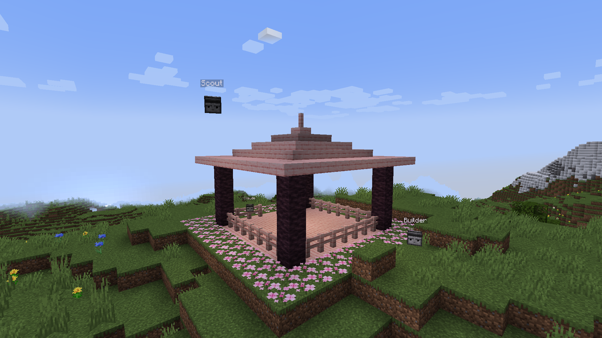

# ClaudeCraft



Fabric-мод для Minecraft 1.20.1 (сборка TRAVELCORE). Поднимает локальный MCP-сервер, через который Claude
выполняет команды в открытом мире, изучает реестры и управляет агентами — сущностями, от лица которых
выполняются команды и делаются скриншоты.

Работает в одиночной игре и при хостинге мира по LAN (MCP-сервер живёт у хоста). На выделенном сервере
мод только регистрирует сущность агента. Мод нужен всем игрокам, которые подключаются к миру.

## Подключение к Claude Code

Запустить игру с модом, затем один раз:

```
claude mcp add --transport http claudecraft http://127.0.0.1:8765/mcp
```

Сервер стартует вместе с игрой и слушает только `127.0.0.1`. Если игра запущена после Claude Code —
переподключиться через `/mcp`.

## Инструменты

| Инструмент | Назначение |
|---|---|
| `execute_command` | Выполнить команду с уровнем прав агента и получить её вывод. По умолчанию от лица агента: `@s` — агент, `~ ~ ~` — его позиция |
| `complete_command` | Автодополнение (как Tab), включая модовые команды и id из реестров |
| `command_usage` | Синтаксис ветки команды на любой глубине; пустой ввод — список всех команд |
| `list_registries` | Все реестры (статические и data-driven) с числом элементов и тегов |
| `list_registry_entries` | Элементы реестра с фильтром и постраничным выводом |
| `list_registry_tags`, `get_tag_entries` | Теги реестра и их содержимое |
| `agent_spawn`, `agent_attach`, `agent_list`, `agent_remove` | Управление агентами; сессия привязывается к своему агенту |
| `agent_request_permission` | Понизить уровень прав агента сразу или попросить хоста повысить его |
| `screenshot` | Скриншот глазами агента (или игрока-хоста) без HUD |
| `peek_notes` | Сколько заметок оставлено агенту, без их получения |
| `take_notes` | Забрать заметки агента: что выделено (с текущим состоянием блоков или сущности) и текст. Полученные заметки удаляются из мира |
| `get_state` | Позиции агента и хоста, блок под взглядом агента, время, погода, пауза, открытый экран |

Агента двигают обычными командами: `tp @s ~ ~ ~5`, `tp @s ~ ~ ~ facing 0 64 0`. Для игроков агент не
прыгает, а плавно перелетает и поворачивается (от 0,2 с на шаг до 2 с на дальний перелёт); это чисто визуальный
эффект на клиенте, сервер, команды и снимки используют точную позицию сразу. Агентов можно создавать и
командой `/summon claudecraft:agent` (имя берётся из `CustomName` или назначается автоматически).

## Заметки для агентов

Перо (`claudecraft:quill`, вкладка «Инструменты» творческого режима) позволяет показать агенту, что нужно сделать:

| Действие | Результат |
|---|---|
| ПКМ по агенту | привязать перо к агенту |
| ЛКМ / ПКМ по блоку | первый / второй угол области (один клик — один блок) |
| ПКМ по сущности | выделить сущность |
| Shift + ПКМ | написать заметку для привязанного агента |
| Shift + ЛКМ по блоку в рамке или по сущности | удалить заметку (автор или хост) |

Заметки видны в мире оранжевыми рамками с подписью, текущее выделение пера — голубой рамкой. Когда Claude
забирает заметки через `take_notes`, они исчезают; удаление происходит только после того, как ответ MCP
успешно отправлен, так что при обрыве связи заметки не теряются.

## Права агентов

Каждый агент выполняет команды с уровнем прав `defaultPermissionLevel` (по умолчанию 2: `tp`, `give`, `fill`,
`summon`, `gamerule`…), пока хост не выдаст больше. Команды «от лица игрока» (`as: "player"`) ограничены тем же
уровнем и правами самого игрока, так что обойти ограничение через них нельзя.

Повышение: `agent_request_permission` присылает хосту в чат запрос с кнопками **[Разрешить]** / **[Отказать]**
и ждёт ответа до `permissionRequestTimeoutSeconds`. Хост может и сам управлять уровнями:

```
/claudecraft permission set <агент> <0-4>
/claudecraft permission reset <агент>
```

Команду `/claudecraft` может выполнить только хост лично: агент не запустит её даже через `execute as`.
Выданные уровни хранятся в сохранении мира отдельно от сущности, поэтому их нельзя изменить через `/data`.

## Ограничения

- Скриншот рисует клиент хоста, поэтому агент должен быть в том же измерении, что и хост, и в пределах его
  дальности прорисовки. Во время снимка хост около секунды видит картинку от лица агента.
- Окно игры не должно быть свёрнуто.
- Пауза при потере фокуса работает как обычно, но на время инструментов, которым нужен работающий мир
  (команды, снимки, агенты), мод закрывает меню паузы и не даёт игре снова встать на паузу. Через полсекунды
  после завершения игра снова уходит на паузу, если окно всё ещё без фокуса; если игрок вернулся в окно,
  игра продолжается. Другие экраны, ставящие игру на паузу (например, настройки), мод не закрывает.
- Агент держит загруженными чанки вокруг себя, поэтому команды работают в любой точке мира.

## Настройки

`config/claudecraft.json`:

| Поле | По умолчанию | Описание |
|---|---|---|
| `port` | `8765` | Порт MCP-сервера |
| `token` | `""` | Если задан — требуется заголовок `Authorization: Bearer <token>` |
| `defaultPermissionLevel` | `2` | Уровень прав агентов по умолчанию (0–4) |
| `permissionRequestTimeoutSeconds` | `120` | Сколько ждать ответа хоста на запрос прав |
| `blockedCommands` | `["stop"]` | Запрещённые команды (проверяются и внутри `execute ... run`) |
| `maxAgents` | `8` | Максимум агентов в мире |
| `broadcastFeedbackToOps` | `true` | Показывать операторам в чате, что делают агенты |
| `screenshotWidth` | `1024` | Ширина скриншота по умолчанию |
| `screenshotWarmupMillis` | `1000` | Сколько миллисекунд рендерить от лица агента перед снимком |
| `jpegQuality` | `0.85` | Качество JPEG |
| `toolTimeoutSeconds` | `15` | Таймаут ожидания игры |

## Сборка

```
./gradlew build
```

Готовый jar — `build/libs/claudecraft-<версия>.jar`.
